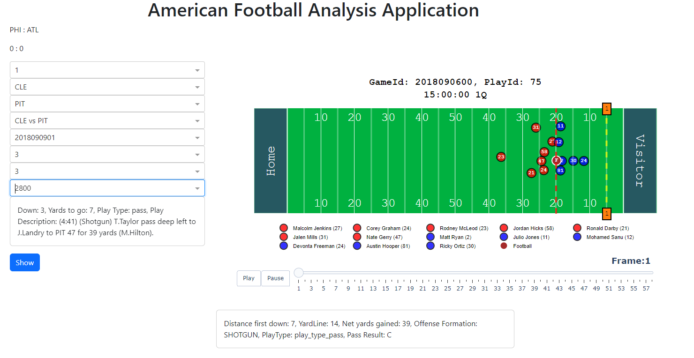
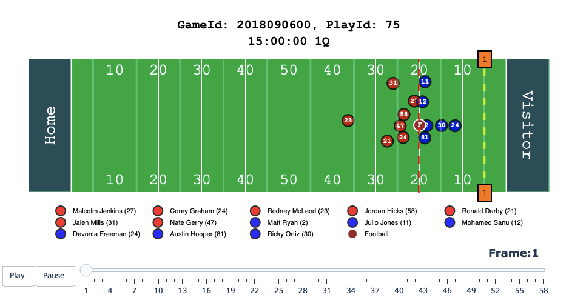
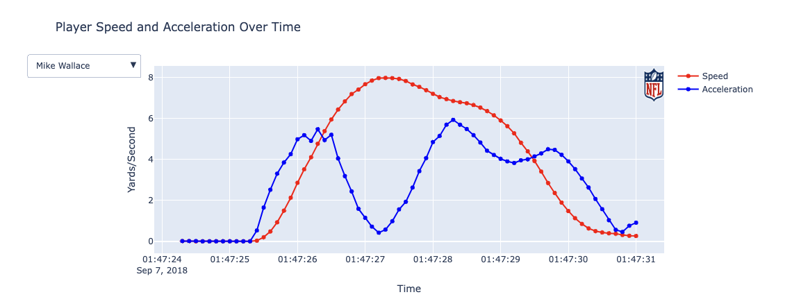
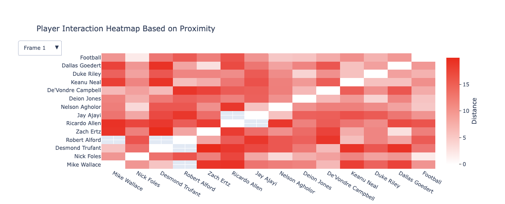
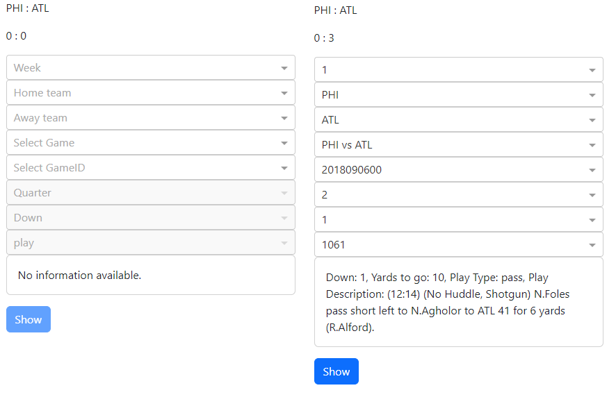

# NFL Play Analyzer: Interactive Visual Analytics for American Football

An interactive web dashboard that turns 18 million rows of NFL player-tracking data into animated plays and player-level charts that coaches and analysts can explore in a few clicks.



> **Interactive dashboard.** Pick a week, teams, game, quarter, down and play, then click *Show* to watch the play unfold frame by frame.

---

## TL;DR

Raw tracking data shows each player's x/y position about ten times per second. That is millions of rows that no coach will ever read. This dashboard reduces it to **one animated play plus two player-level charts**: who ran where, how fast, and who was close to whom.

[Placeholder: headline data finding, e.g. a tactical pattern you discovered with the tool]

## Why this matters

- **Coaches** can review a single play visually instead of scrubbing through video. They see formation, line of scrimmage, first-down marker and every player's path.
- **Analysts** can drill down from a full season to one play using linked filters. Each filter only offers options that are valid for the selections above it.
- **Athletic / position coaches** can check a player's acceleration bursts and slowdowns within a play.
- **Scouts** can compare how players move and how close they stay to opponents, based on tracking data rather than impressions.

## Key insights

### 1. A whole play becomes readable in seconds
Each play is animated from its tracking frames (around 80 frames per play, around 100 plays per game). Home team is red, away team is blue, the ball is brown. The line of scrimmage and first-down marker are drawn on the field, and Play/Pause controls plus a frame slider let users step through the play.



### 2. Speed profiles expose bursts and fatigue
Users pick any player in the play from a dropdown. In the example play, Mike Wallace goes from standstill to a peak of roughly 8 yards/second in about two seconds, then decelerates as the play ends.



### 3. Proximity shows who is really covering whom
A heatmap shows each player's distance to every other player and to the ball, frame by frame. Analysts can use it to see whether a defensive line stays compact or whether a receiver gets separation. Distances above 20 yards are cut off to keep the chart readable.



### 4. From 2.3 GB to one play in a few clicks
Linked dropdowns (week → home team → away team → game → quarter → down → play) narrow the search step by step. An info box gives an overview before anything is rendered: down, yards to go, play type and the official play description. The expensive plots are only drawn when the user clicks *Show* (*overview first, zoom and filter, then details on demand*).



## Data

| | |
|---|---|
| **Source** | NFL tracking data published on Kaggle ([NFL Big Data Bowl 2021](https://www.kaggle.com/competitions/nfl-big-data-bowl-2021)) |
| **Season** | 2018 NFL regular season, weeks 1–17 (Sep 6 – Dec 30, 2018) |
| **Scope** | 253 games · 32 teams · 19,239 passing plays · 1,303 players |
| **Tracking** | 18.3 million position records (x, y, speed, acceleration, orientation, direction) for every player and the ball; 17 weekly CSVs, ~2.3 GB |

**Preprocessing**
- Unused columns are dropped on first load.
- The 17 weekly tracking files are merged into a single DataFrame.
- Missing and duplicate values were checked and removed. Missing values were negligible and almost all came from the ball, which is stored as a "player" without a jersey number.
- Tracking data is joined to game and play metadata via `gameId` / `playId`.

## Tech stack

**Python 3.12 · Dash · Plotly · dash-bootstrap-components · dash-ag-grid · pandas · NumPy**

How it is built:
- **Data layer (API module):** loads, cleans and merges the CSVs and provides filtered data to the views.
- **View layer (Dash + Bootstrap):** filter panel on the left, plots on the right; `dash_ag_grid` for tabular data.
- **Controller (Dash callbacks):** chained callbacks power the linked filters. Plots are built with Plotly, and animation, the player dropdown and the frame selector run inside the figures. This avoids extra server round-trips.
- **Design approach:** user-centered design with input from team members who have American football experience. Prototyped on paper first ([sketch](assets/ui-prototype-sketch.png)).

## Run it yourself

**1. Get the data.** Download the CSVs from [Kaggle](https://www.kaggle.com/competitions/nfl-big-data-bowl-2021/data) and place `games.csv`, `plays.csv`, `players.csv` and `week1.csv` … `week17.csv` in `data/`.

**2. Install dependencies** (Python 3.12):

```bash
# Option A: the exact environment (pinned on Windows)
conda env create -f environment.yml
conda activate working-dir-va

# Option B: any OS
pip install dash==2.17.0 dash-bootstrap-components==1.6.0 dash-ag-grid==31.2.0 plotly==5.22.0 pandas==2.2.2 numpy==1.26.4 matplotlib==3.9.0
```

**3. Start the dashboard** from the repository root (the data paths are relative):

```bash
python gui.py
```

Then open http://127.0.0.1:8002 in your browser. The first load takes a while because all 17 weekly files are read into memory. Tip: pause the animation before selecting the next play.

## Repository structure

```
.
├── gui.py                                  # Dash dashboard: layout, linked filters, callbacks (entry point)
├── main.py                                 # convenience launcher for gui.py
├── api.py                                  # data loading & preprocessing (NFLDataAPI)
├── gamefield.py                            # animated football field (Plotly)
├── additionalplots.py                      # speed/acceleration chart & proximity heatmap
├── requirements.txt / environment.yml      # dependencies
├── data/                                   # Kaggle CSVs (not versioned, see "Run it yourself")
├── assets/                                 # screenshots for this README
├── Visual_Analytics_Report_Group_25.pdf    # full project report
└── VA presentation final.pptx              # final presentation slides
```

## Full report

For design rationale, implementation details and a discussion of limitations and next steps, see:
- 📄 [Project report (PDF)](Visual_Analytics_Report_Group_25.pdf)
- 📊 [Final presentation (PPTX)](VA%20presentation%20final.pptx)

**Next steps from the report:** game-wide player heatmaps, lazy loading for faster startup, and a more polished UI.

---

Team project for the *Visual Analytics* course at TU Graz
Lukas Brandner, Robert Oswald, Konstantin Benischke and Marc Velmeden.
